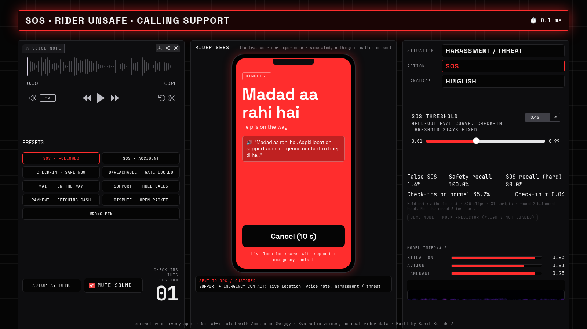
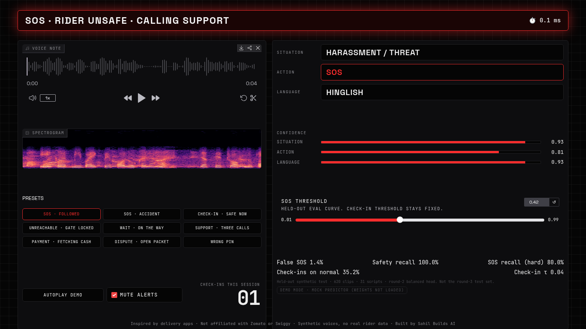

# HelmetMind

Voice-note decisions for last-mile delivery riders.

<p align="center">
  
</p>

*Illustrative dispatch-console screenshot from a demo / mock run. The metrics in the shot are not the official results; those are in the table below.*

A short rider voice note goes in — *"customer ka gate band hai, phone nahi utha raha"* — and **calibrated probabilities over a fixed set of decisions** come out, in one pass, with no transcription step.

A concept for Indian last-mile delivery, built on synthetic data. **Not affiliated with any delivery platform.**

## Results

Held-out **synthetic test set**, round-3 (m1v3, spec 0.4.0): 37 scripts / 740 clips. Intervals resample scripts, not clips.

| Metric | Result |
|---|---|
| Situation accuracy | 82.3 |
| Next-action accuracy | **72.6** [script-level CI 63.1–81.1] |
| Language accuracy | 85.7 |
| Safety recall | 100% (15 / 15 safety scripts) |
| False SOS on normal clips | 0.7% |
| Any alert on true SOS | 100% |
| Check-in rate on normal clips | 33.6% |
| `call_customer` recall | 44.3 |
| Latency (T4, fp16, batch 1, after warmup) | p50 604 ms · p95 614 ms |

On the earlier **round-2** test set: action 75.0, false SOS 0.7%. Shipped thresholds: `sos_tau` 0.42, `checkin_tau` 0.04, `safety_tau` 0.02.

The trained head lives in the private Hub repo [`sahildl/rider-voice-decisions-m1v3`](https://huggingface.co/sahildl/rider-voice-decisions-m1v3) (`head.safetensors` and `head.pt`). The model card keeps out-of-fold threshold-fit rates separate from these test figures, and has the per-class, SNR and language breakdowns.

The model **suggests**; a person confirms. It is not a production safety system.

## What it decides

| Question | Options |
|---|---|
| **situation** | customer_unreachable · wrong_address · restaurant_delay · order_issue_at_pickup · food_spilled_or_damaged · vehicle_breakdown · road_blocked_or_weather · payment_issue · customer_dispute · accident_or_injury · harassment_or_threat · other_or_unclear |
| **action** | wait · call_customer · contact_support · request_reassign · return_to_restaurant · sos |
| **safety** | yes / no — thresholded for high recall, then a two-level SOS / “Are you safe?” check-in |
| **language** | hinglish · hindi · english |

The published m1v3 head scores a **scoped** subset of that taxonomy (seven situations and four actions: wait, call_customer, contact_support, SOS). Out-of-scope options are masked.

## Live demo

A Gradio dispatch console lives in [`space/`](space/). Record or upload a short rider voice note — or click a preset — and the model returns the situation, next action, language, and a two-level safety alert (SOS, or an “Are you safe?” check-in). The rider-phone panel and the ops view of the same SOS beat:

<p align="center">
  
</p>

*Same mock / demo caveat as the hero image above.*

A hosted Hugging Face Space is intended at [sahildl/rider-voice-decisions](https://huggingface.co/spaces/sahildl/rider-voice-decisions). It is **not up yet**: hosting a Gradio Space on `cpu-basic` now requires a Hugging Face Pro subscription, which this account does not have.

Until then, you can host the same console on Kaggle and read a public live link from the logs:

1. Import [`space/kaggle_live_demo.ipynb`](space/kaggle_live_demo.ipynb) (File → Import Notebook).
2. Set **Accelerator** to **GPU T4 x2**, turn **Internet** on, and attach a Kaggle secret named `HF_TOKEN` (a **read** token for the sahildl account that can access the private head repo).
3. Click **Save Version → Save & Run All (Commit)** and close the tab. A committed run does not depend on the editor staying open.
4. After the model has downloaded and loaded (around 10 minutes), open that version’s **Logs** and search for `PUBLIC LIVE DEMO LINK`. The URL is reprinted every 5 minutes, so it stays near the bottom of the log.

The session auto-stops after 3 hours (`DEMO_MAX_HOURS`). Cancel earlier if you are done, so you don’t burn the free GPU quota. Gradio share links also expire after about 72 hours.

To run the console locally without trained weights:

```bash
cd space
pip install -r requirements.txt  # or: pip install gradio matplotlib soundfile scipy pillow
MOCK=1 python app.py
```

Weights are not stored in this repository. They live in the private Hub repo [`sahildl/rider-voice-decisions-m1v3`](https://huggingface.co/sahildl/rider-voice-decisions-m1v3) (`head.safetensors` plus the original `head.pt` that the demo engine loads). To load them:

```bash
# download at startup (needs a token if the model repo is private)
HF_MODEL_REPO=sahildl/rider-voice-decisions-m1v3 python app.py

# or extract a local results zip
python space/scripts/load_run.py --run-zip <results.zip> --run-name m1v3
python app.py
```

You can also place `head.pt`, `config.json`, `t_entropy.json`, and `thresholds.json` in `space/run/` by hand.

## How it works

- **Backbone:** [nirnaya-flash-1.0](https://huggingface.co/Darkrider/nirnaya-flash-1.0) (Gemma 4 E4B, reads audio natively), **frozen**. The clip and a fixed text request (one state + four questions, each option written out) go in once; the final hidden states come out.
- **Head:** the joint decision head from [nirnaya-inference](https://github.com/NeverInAsh/nirnaya-inference) (`mmclm/jh.py`) reads the state, question and option spans and scores every option of every question at once. We warm-start from the released head and train only the head, on cached features — minutes on a free T4.
- **Calibration:** an entropy-aware temperature per question, fit on out-of-fold logits (never on test). It never changes the chosen option, only how confident it is.
- **Request format:** the [Decision Index](https://github.com/apolinario/decision-index) `state` + typed `questions` interface (`choice` with `criteria`, `noul` for yes/no). The whole decision set is one file: [`spec/decision_set.json`](spec/decision_set.json).
- **Alerts:** SOS if p(action = SOS) ≥ `sos_tau`; a check-in if the combined safety score — max(p(safety), p(accident or harassment), p(SOS)) — is at or above `checkin_tau`.

## How it is meant to be used

The model **suggests; the rider confirms with one tap.** It never executes an action on its own.

- The top action is shown as one big button, with the runner-up and "talk to support" beside it.
- **Safety always escalates to a human.** The two-level rule can raise an SOS or an “Are you safe?” check-in; nothing in the system lets the model suppress an alert.
- When confidence is low (or the situation is `other_or_unclear`), the rider gets the top two actions plus support instead of a single suggestion.
- **Consistency:** when a safety alert fires, the suggested action is restricted to SOS or support, whatever the action head says on its own.

## Labels are derived, not hand-picked

Every training script carries its situation plus structured cues (`attempts`, `waited_min`, `near_restaurant`, …). The gold **action** and **safety** labels are computed from those cues by the rules in `spec/decision_set.json` (`src/labels.py`). For example, *customer unreachable* defaults to **call_customer**, but after two call attempts or ten minutes of waiting it becomes **contact_support**. Accidents and threats are always safety = yes, even when the rider says they are fine.

```bash
python src/labels.py     # self-test: 12 situations, 6 actions (all reachable), rule cases
python src/request.py    # prints the request and the exact prompt text the backbone reads
```

## Data

- **Training set used for m1v3** (see the [model card](https://huggingface.co/sahildl/rider-voice-decisions-m1v3)): **285 scripts, 2,512 clips**, split by script (never by clip) into 195 / 53 / 37 train / validation / test scripts. Train+validation: 1,560 + 212 = 1,772 clips; held-out test: 740 clips. Voices and noise variants of a test script never appear in training.
- **Scripts in this repo:** the reviewed door-step wedge (130) and round-2 additions (86) are in `data/scripts/` (`m1_v2.jsonl` is the built 216-script file). Round-3 added further scripts for the 285-script run; those extra scripts are not vendored here yet.
- **Synthetic audio:** multi-voice TTS ([Indic Parler-TTS](https://huggingface.co/ai4bharat/indic-parler-tts), Apache-2.0), then a noise and channel chain — traffic, horns, engine, wind, rain, crowd, a helmet filter, a phone-mic band-pass and a low-bitrate codec round-trip. Fixed-seed evaluation tiers at clean / 20 / 10 / 5 / 0 dB SNR. The audio itself is not in this repository.
- **Real-voice test:** a recording kit and label format live in `data/real/` (situation cards, not scripts). **It has not been run yet.** The published head has not been validated on real rider recordings.

## Evaluation

**Run on the held-out synthetic test set** (same clips, batch 1, after warmup):

- this model (m1v3 head), numbers in [Results](#results)
- the released head, zero-shot, in the same label scope — next-action accuracy **+19.1 points** over that baseline
- a 20/20 backbone parity check, which passed before this head was trained
- latency on a T4 in fp16 (p50 604 ms, p95 614 ms)

The training notebook (`notebooks/02_kaggle_train.ipynb`) also computes accuracy and macro-F1 per question, safety recall and false-alarm rates with script-level intervals, calibration diagnostics (ECE / NLL / Brier), accuracy against SNR, and per-language results. Thresholds are fit on out-of-fold train+validation clips, never on test.

### Planned

These comparisons are not in the repo and have not been run. Do not treat them as completed results:

- Whisper large-v3-turbo → LLM (option log-probabilities), the usual cascade
- Whisper → the same backbone’s text path → a head trained on transcripts (audio-native vs transcribe-then-decide)
- a real-rider voice test set (the kit in `data/real/` is ready; no labelled clips are in the repo)

## Run it on Kaggle (free T4s)

Two push-button notebooks in `notebooks/` (they are separate because the TTS library pins an older `transformers`), plus a live-demo notebook in `space/`:

1. **`01_kaggle_audio.ipynb`** — GPU T4, Internet on, secret `HF_TOKEN` (accept the Indic Parler-TTS terms on the Hub once). Scripts → TTS → noise and phone chain → `rv-audio/` (clips + manifest). ~1 h for the 130-script wedge.
2. **`02_kaggle_train.ipynb`** — GPU **T4 x2**, Internet on, with notebook 01’s output attached. Backbone parity check → features (one forward per clip) → zero-shot baseline → train the head → calibrate → evaluate → latency.
3. **`space/kaggle_live_demo.ipynb`** — GPU **T4 x2**, Internet on, secret `HF_TOKEN` (sahildl read token). Hosts the dispatch-console Gradio app. Self-contained; you do not need to attach this repo as a dataset. Prefer **Save Version → Save & Run All (Commit)**, then search the Logs for `PUBLIC LIVE DEMO LINK` (reprinted every 5 minutes; auto-stops after 3 hours).

For the training notebooks, attach this repo folder as a Kaggle dataset (or set `REPO_URL`). Every stage is resumable: if a session stops, re-run.

## Run it locally

```bash
pip install -r requirements.txt
git clone https://github.com/NeverInAsh/nirnaya-inference && export PYTHONPATH=$PWD/nirnaya-inference:$PWD

python src/scripts.py build --raw data/scripts/m1_wedge.raw.jsonl data/scripts/m1_round2.raw.jsonl \
                           --out data/scripts/m1_v2.jsonl --freeze-splits data/scripts/m1_wedge.jsonl
python src/tts.py      --scripts data/scripts/m1_v2.jsonl --out data/audio/tts            # separate env with parler-tts
python src/fetch_noise.py --out data/noise
python src/augment.py  --tts-manifest data/audio/tts/tts_manifest.jsonl --scripts data/scripts/m1_v2.jsonl \
                       --noise-dir data/noise --out data/audio/clips
python src/parity.py   --model <nirnaya-flash-1.0 dir>                                       # must PASS first
python src/extract.py  --model <model dir> --manifest data/audio/clips/manifest.jsonl --out features
python train/train_head.py --features features --out runs/m1 --init <model dir>/head.pt --subset m1
python train/crossfit.py   --run runs/m1 --folds 5
python train/calibrate.py  --run runs/m1 --init-fit <model dir>/t_entropy.json
python train/predict.py    --run runs/m1 --features features --splits test --subset m1 --out runs/m1/pred_test.jsonl
python train/evaluate.py   --pred ours=runs/m1/pred_test.jsonl --out results/m1
python src/engine.py       --model <model dir> --run runs/m1 some_clip.wav --bench 50
```

The trained `head.pt` keeps the released `{"cfg", "state"}` format, so it also loads in the original nirnaya-inference engine. `head.safetensors` in the Hub repo is the same `state` tensors in safetensors form.

## Repo layout

```
spec/decision_set.json      the decision set: state, four questions, action rules, safety rules, language rule
src/labels.py               gold action/safety from cues (+ self-test)
src/request.py              the request and the exact prompt text the backbone reads
src/scripts.py              slot grid, LLM drafting, lint + dedup, labels, script-level splits
src/tts.py                  Indic Parler-TTS renders (speaker-disjoint train vs val/test voices)
src/augment.py              helmet, road noise at SNR, wind, phone band, codec, AGC, packet loss (+ self-test)
src/fetch_noise.py          real background noise (MS-SNSD) sorted into the chain's categories, train/test kept apart
src/backbone.py             frozen backbone on 2x T4 / CPU: prompt, forward, spans, pooling
src/parity.py               P0 gate: released head on our features, 20 easy decisions
src/extract.py              one forward per clip -> cached features (resumable)
src/decide.py               features -> head logits -> calibrated probabilities -> answers
src/product.py              the one-tap card and the SOS rules (+ self-test)
src/engine.py               wav -> answers + card, latency benchmark
src/metrics.py              accuracy, macro-F1, ECE, NLL, Brier, Wilson CIs, AUROC, bootstrap (+ self-test)
src/real_manifest.py        real recordings (labels.csv) -> manifest
train/train_head.py         warm-start the joint head on cached features, early stopping
train/crossfit.py           out-of-fold logits over train+val scripts (more safety cases for the threshold)
train/calibrate.py          per-question temperature + safety threshold (recall + per-script floor), never on test
train/predict.py            features + run -> predictions.jsonl
train/evaluate.py           predictions -> metrics.json + REPORT.md (script-level CIs, per-class recall, per-script table)
notebooks/                  the two Kaggle training notebooks and their builder
tests/                      tiny random Gemma 4 with the real tokenizer/processor; full pipeline test on CPU
data/                       reviewed scripts (wedge + round 2) and the real-clip label kit
docs/                       backbone notes; README screenshots in docs/assets/
space/                      self-contained Gradio dispatch console + Kaggle live-demo notebook
```

`space/src/` is a **packaging copy** of the inference modules, plus demo-only files (`alert_rules.py`, a torch-free alert rule used by the UI and the threshold curve; `rider_copy.py`, rider-facing strings). The training and evaluation source of truth is the top-level `src/` tree. The two copies have drifted on purpose in places — do not blindly overwrite one with the other. The Kaggle notebook writes its own files and does not import this tree as a package from Git.

Tests: `python src/labels.py && python src/metrics.py && python src/product.py && python src/augment.py --selftest`,
then `python tests/test_pipeline_tiny.py --nirnaya <nirnaya-inference dir>` (every stage end to end, ~2 min on CPU).

## Limitations (known up front)

- **Synthetic voices only.** The published head has not been validated on real rider recordings. Accents, devices, and genuinely messy field audio will differ.
- **Anxious check-ins.** About a third of normal notes in the test set still trigger an “Are you safe?” check-in (33.6%). That is a deliberate trade-off so that no safety script in this test set is missed, not a claim of precision.
- **`call_customer` is weak** (recall 44.3%). Next-action accuracy is the weakest of the four heads and drops further in heavy noise (60.8 at 0 dB SNR).
- Hindi vs Hinglish is a fuzzy line in speech. A loanword rule makes the labels consistent, not the boundary real.
- Options are scored in a fixed order (features are cached once per clip). This milestone does not score every situation or action in the product taxonomy.
- This is a research concept, not a safety system. Do not rely on it as the only check in an emergency.

## Licence and credit

Apache-2.0 — see [LICENSE](LICENSE) and [NOTICE](NOTICE). Built on nirnaya-flash-1.0 (a modified Gemma 4 E4B) and the nirnaya-inference code by Anshik Bansal; “Nirnaya” is his name and is used here only to say where this work comes from. Request format and evaluation style follow the Decision Index kit by Apolinário Passos; no Decision Index suite data is used.

**Not affiliated with any delivery platform.** Built by Sahil Builds AI.
